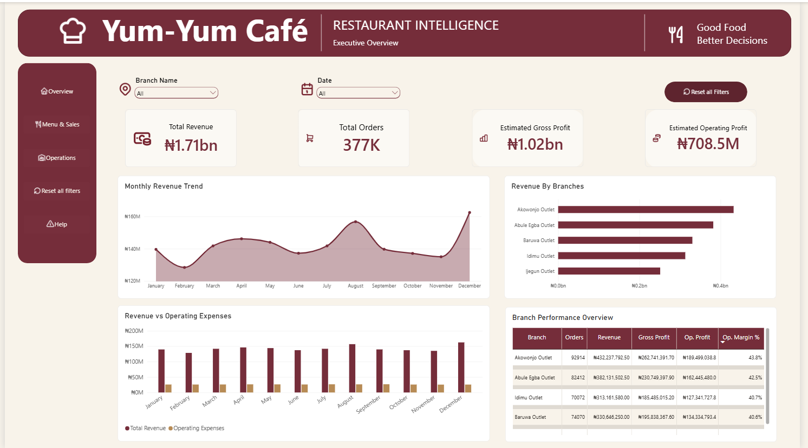
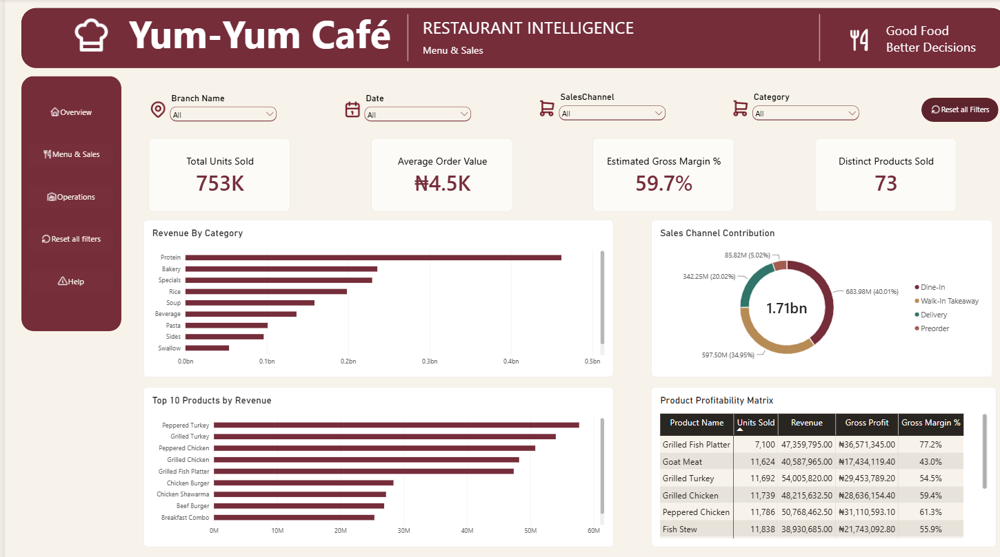
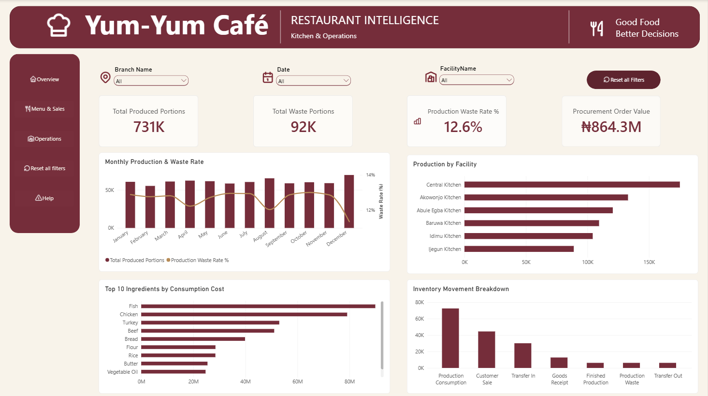
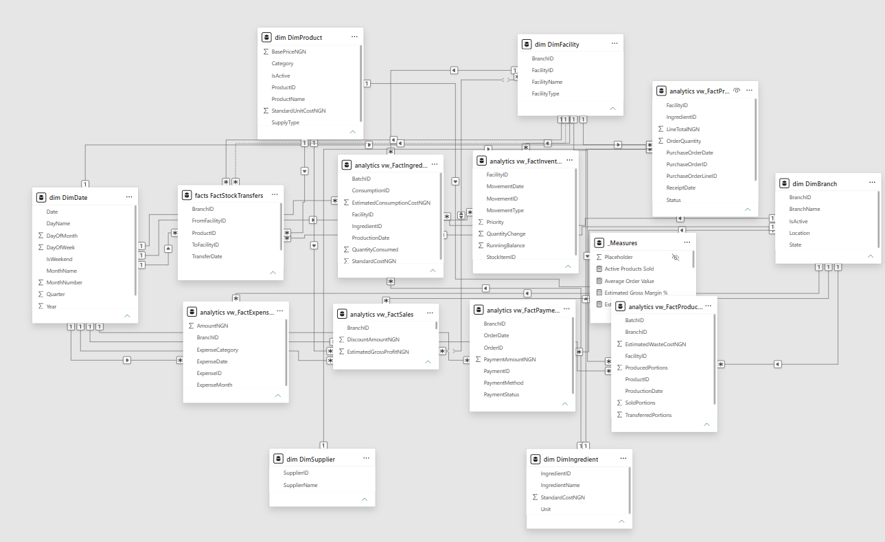

# Restaurant Intelligence Platform

### End-to-End Business Intelligence | Python • SQL Server • Power BI

An end-to-end business intelligence solution that transforms synthetic restaurant operations data into actionable financial, sales, and operational insights.

Built around a simulated Nigerian quick-service restaurant group operating **five outlets and one central production kitchen**, the platform integrates sales, menu profitability, procurement, ingredient consumption, kitchen production, inventory activity, and operating expenses.

The objective is to demonstrate how a business can move beyond basic sales reporting to understand **what generates revenue, what contributes to profitability, and where operational costs require attention**.

> **Project disclosure:** This is an independent portfolio project built with synthetic data. All business entities, transactions, financial results, and operational findings are simulated.

---

## 1. Business Problem

A multi-branch restaurant business generates information across several operational areas:

- Sales and customer orders.
- Menu products and pricing.
- Ingredient purchasing and consumption.
- Kitchen production and food waste.
- Inventory movements.
- Operating expenses.

When these activities are analyzed separately, management may have limited visibility into the relationship between revenue, profitability, and operational efficiency.

This project addresses three business priorities:

1. **Sales & Revenue Intelligence:** Understand revenue drivers, sales trends, branch performance, and menu demand.
2. **Food Costs & Operational Efficiency:** Analyze ingredient consumption, procurement, production, waste, and inventory activity.
3. **Financial Performance:** Evaluate estimated gross profit, operating expenses, operating profit, and margins.

---

## 2. Solution Overview

The solution follows an end-to-end analytical workflow:

**Python Data Generation → CSV Files → SQL Server Staging → Dimensional Modeling → Analytical SQL Views → Power BI Dashboards**

### Technology Stack

| Technology | Purpose |
|---|---|
| Python | Synthetic data generation and validation |
| Pandas & NumPy | Data preparation and generation |
| SQL Server | Relational storage, transformations, and analytical processing |
| SQL | Data modeling, reporting views, and business analysis |
| Power BI | Data modeling, DAX measures, and interactive dashboards |
| GitHub | Version control and project documentation |

### Business Coverage

The simulated restaurant group operates across five Lagos locations:

- Akowonjo
- Abule Egba
- Baruwa
- Idimu
- Ijegun

A central production kitchen supports the modeled operational network.

---

## 3. Power BI Dashboard

The completed Power BI report contains three interactive pages covering executive performance, menu analytics, and kitchen operations.

### Dashboard 1 — Executive Overview



Provides a consolidated view of business performance, including revenue, orders, estimated profitability, branch comparisons, and financial trends.

**Key metrics:**

| Metric | Result |
|---|---:|
| Total Revenue | ₦1.71B |
| Total Orders | 377K |
| Estimated Gross Profit | ₦1.02B |
| Estimated Operating Profit | ₦708.5M |

### Dashboard 2 — Menu & Sales



Analyzes menu performance across products, categories, and sales channels, helping distinguish sales volume from profitability.

**Key metrics:**

| Metric | Result |
|---|---:|
| Units Sold | 753K |
| Average Order Value | ₦4.5K |
| Estimated Gross Margin | 59.7% |
| Distinct Products Sold | 73 |

### Dashboard 3 — Kitchen & Operations



Provides visibility into production activity, food waste, procurement, ingredient consumption costs, and inventory movements.

**Key metrics:**

| Metric | Result |
|---|---:|
| Produced Portions | 731K |
| Waste Portions | 92K |
| Waste Rate | 12.6% |
| Procurement Order Value | ₦864.3M |

---

## 4. Data Architecture & Modeling

The analytical solution uses Microsoft SQL Server with four main schemas:

| Schema | Responsibility |
|---|---|
| `stg` | Imported synthetic source data |
| `dim` | Descriptive analytical dimensions |
| `facts` | Business transactions and measurable events |
| `analytics` | Reporting-ready SQL views |

The Power BI model brings together multiple business processes using dimensional modeling principles.

### Power BI Data Model



The model includes dimensions for branches, products, facilities, ingredients, suppliers, and dates, alongside fact datasets for sales, production, procurement, expenses, payments, ingredient consumption, inventory movements, and stock transfers.

A dedicated measures table organizes DAX calculations used throughout the report.

This multi-fact model supports analysis across financial and operational reporting areas.

---

## 5. Key Business Insights

Five analytical findings were verified using SQL Server.

### Insight 1 — Highest Revenue Does Not Tell the Whole Branch Story

**Akowonjo** generates the highest branch revenue at approximately **₦432.24M**, with an estimated operating margin of **43.84%**.

Ijegun records the lowest estimated operating margin at **37.75%**.

**Business implication:** Branch performance should be assessed using profitability and operating expenses alongside revenue.

### Insight 2 — The Highest-Revenue Product Is Not the Highest-Profit Contributor

**Peppered Turkey** generates the highest product revenue at approximately **₦57.70M**.

However, **Ofada Rice** generates the highest estimated gross profit at approximately **₦36.62M**, with a gross margin of **79.17%**.

**Business implication:** Menu decisions should consider estimated gross profit and margin alongside revenue and demand.

### Insight 3 — Revenue Leadership and Margin Leadership Differ by Category

**Protein** is the largest revenue category at approximately **₦461.95M**, contributing approximately **₦230.76M** in estimated gross profit.

**Rice** achieves the highest category gross margin at **77.14%**, compared with Protein's **49.95%**.

**Business implication:** Category performance should be evaluated using both absolute contribution and margin percentage.

### Insight 4 — Waste Rate and Waste Cost Identify Different Priorities

**Ijegun Kitchen** records the highest production waste rate at **18.94%**.

**Akowonjo Kitchen** records the highest estimated waste cost at approximately **₦19.08M**.

**Business implication:** Operational monitoring should consider both proportional waste and absolute financial exposure.

### Insight 5 — Fish and Chicken Are Major Ingredient Cost Drivers

**Fish** records the highest estimated ingredient consumption cost at approximately **₦89.90M**, followed by **Chicken** at **₦79.10M**.

Together, they account for approximately **₦169M** in modeled consumption costs.

**Business implication:** High-cost ingredients are useful starting points for purchasing-price and consumption reviews, although high cost alone does not indicate inefficiency.

For detailed SQL-verified findings and interpretations, see [Business Analysis & Insights](05_Documentation/04_Analysis_and_Insights.md).

---

## 6. Technical Implementation

### Phase 1 — Data Generation

Developed Python scripts to generate synthetic restaurant datasets covering:

- Branches, facilities, suppliers, ingredients, and products.
- Recipes and recipe components.
- Procurement orders and goods receipts.
- Customer orders and payments.
- Production and ingredient consumption.
- Inventory records and movements.
- Financial operating expenses.

The datasets were validated before loading into SQL Server.

### Phase 2 — SQL Development

Created a structured SQL environment to support:

- Source data staging.
- Data transformations.
- Dimension and fact tables.
- Reusable analytical views.
- Business performance queries.

Analytical views provide reporting-ready data for Power BI.

### Phase 3 — Power BI Development

Built an interactive three-page report with:

- Business KPI measures.
- Branch and product comparisons.
- Revenue and profitability analysis.
- Production and waste reporting.
- Ingredient consumption analysis.
- Procurement and inventory reporting.

### Phase 4 — Business Analysis

Executed SQL queries to investigate branch profitability, product and category performance, kitchen waste, and ingredient cost drivers.

Translated the results into business interpretations, proposed management actions, and documented limitations.

---

## 7. Repository Structure

```text
Restaurant-Intelligence-Platform/
│
├── 01_Business_Requirements/
│   └── Business_Requirements.md
│
├── 02_Data_Generation/
│   ├── scripts/
│   └── output/
│
├── 03_SQL/
│   ├── 01_schema/
│   ├── 02_staging/
│   ├── 03_transformations/
│   └── 04_analytics/
│
├── 04_PowerBI/
│   └── Restaurant_Intelligence.pbix
│
├── 05_Documentation/
│   ├── 01_Project_Overview.md
│   ├── 02_Data_Architecture.md
│   ├── 03_Data_Dictionary.md
│   ├── 04_Analysis_and_Insights.md
│   └── 05_Recommendations_and_Limitations.md
│
├── images/
│   ├── 01_executive_overview.png
│   ├── 02_menu_and_sales.png
│   ├── 03_kitchen_and_operations.png
│   └── 04_powerbi_data_model.png
│
└── README.md
```

---

## 8. Reproducing the Project

The repository contains the project components required to understand the workflow and rebuild the analytical environment.

### Prerequisites

- Python with the dependencies required by the generation scripts.
- Microsoft SQL Server.
- SQL Server Management Studio.
- Power BI Desktop.

### General Workflow

1. Review the business requirements and data generation scripts.
2. Generate or use the provided synthetic CSV datasets.
3. Create the SQL Server database and required schemas.
4. Load the source datasets into staging tables.
5. Execute the SQL transformation and analytical scripts in dependency order.
6. Open the Power BI report and configure its SQL Server connection for the local environment.
7. Refresh the data model and explore the dashboards.

Local file paths, database connections, and environment settings may require adjustment.

Refer to the SQL scripts and technical documentation for implementation details.

---

## 9. Documentation

Detailed project documentation is available below.

| Document | Description |
|---|---|
| [Business Requirements](01_Business_Requirements/Business_Requirements.md) | Business problem, objectives, reporting requirements, and scope |
| [Project Overview](05_Documentation/01_Project_Overview.md) | Project context, architecture, dashboards, and outcomes |
| [Data Architecture](05_Documentation/02_Data_Architecture.md) | Data flow, SQL modeling, and reporting architecture |
| [Data Dictionary](05_Documentation/03_Data_Dictionary.md) | Dataset structures and field definitions |
| [Business Analysis & Insights](05_Documentation/04_Analysis_and_Insights.md) | Verified findings, interpretations, and supporting evidence |
| [Recommendations & Limitations](05_Documentation/05_Recommendations_and_Limitations.md) | Proposed management actions and analytical constraints |

---

## 10. Project Limitations

This project uses synthetic data and is intended to demonstrate business intelligence development and analytical reasoning.

Important limitations include:

- Financial and operational results are simulated.
- Gross profit and operating profit are estimated using modeled costs.
- The project does not include live restaurant system integrations.
- Descriptive findings do not establish causal relationships.
- Production facilities may differ in responsibilities and product mix.
- No recommendations have been implemented or tested in a real restaurant.
- No actual cost savings, revenue increases, or waste reductions are claimed.

The analytical results should not be interpreted as real-world restaurant performance or industry benchmarks.

---

## 11. Project Outcome

The Restaurant Intelligence Platform demonstrates the development of a multi-domain business intelligence solution, from synthetic data generation and SQL modeling through Power BI reporting and business analysis.

The project brings together technical implementation and business interpretation to answer questions about revenue, profitability, production waste, and ingredient costs.

**The central lesson: Understanding how much a business sells is only the beginning. Effective business intelligence also examines what contributes to profit, what drives costs, and where operational performance deserves further investigation.**

---

### Author

**Demilade Kareem**  
Data & Business Intelligence Analyst

[GitHub Profile](https://github.com/DemiladeKareem)